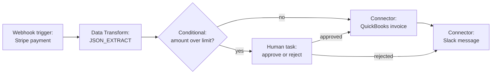
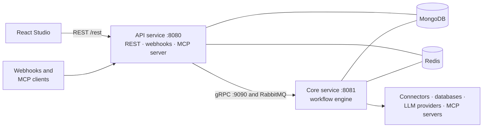

<div align="center">

# Workflow Automation Platform

**Build, run and observe automations visually — webhooks, schedules, 83 app connectors, databases, AI agents and MCP — on infrastructure you own.**

[](LICENSE)
[](https://github.com/manojkunasekaran/workflow/actions/workflows/build.yml)


[Live demo](https://app.manojk.duckdns.org) · [Features](#-features) · [Quick start](#-quick-start) · [Architecture](#-architecture) · [Contributing](#-contributing)

</div>

---

## Why this exists

Most automation tools stop at "call an API when something happens." Real automations need more: branching and parallel paths, loops, waiting for a human to approve something, querying a database, talking to an LLM, and reacting to events from dozens of different apps. And you often want all of that running on your own servers, with your own data.

**Workflow Automation Platform (WAP)** is a self-hostable workflow engine with a visual builder. You design a workflow on a canvas, connect it to the apps you already use, and the engine runs it reliably in the background while you watch every step.

- **Visual first.** Drag tasks onto a canvas, wire them together, test any single node, and inspect every run step by step.
- **Much more than HTTP.** 17 task types: HTTP, scripts, conditions, loops, parallel branches, human approvals, SQL, MongoDB, Redis, Neo4j, email, data transforms, connectors, AI agents and MCP tools.
- **Connected out of the box.** 83 connectors with about 790 actions and over 300 ready-made triggers, covering Slack, Gmail, Stripe, Salesforce, Jira, GitHub, Google Workspace, OpenAI, Anthropic and many more.
- **AI-native.** Run LLM agents inside a workflow, and expose your workflows as tools to any MCP-compatible AI client.
- **Yours to run.** Docker Compose for local use, multi-arch container images for deployment, no vendor lock-in.

### Open source

WAP is **free and open-source software**, released under the **[MIT License](LICENSE)**. You can use it, modify it, self-host it and build commercial products on top of it. Contributions of every size are welcome — see [Contributing](#-contributing).

### Under the hood

A Java 21 / Spring Boot 3 backend split into an **API service** (REST, webhooks, inbound MCP server) and a **Core service** (the workflow engine) that talk over gRPC and RabbitMQ, with MongoDB for storage and Redis for caching. The UI is a React 19 + TypeScript single-page app built on React Flow. Key layer boundaries are checked by architecture tests.

---

## ✨ Features

### Build
- **Workflow Studio**: a canvas editor with undo/redo, drag-and-drop task catalog, a variable explorer, an expression editor, and a raw JSON editor.
- **Test as you build**: run a single node in isolation and see its output before you run the whole workflow.
- **Expressions everywhere**: pass data between tasks with `{{$tasks.fetch_user.body.email}}`, `{{$input.customer_id}}`, `{{$variables.api_base_url}}` and `{{$env.NAME}}`.

### Trigger
Start a workflow manually, from a webhook, on a cron schedule, by polling an endpoint, or from an AI client over MCP. See [Triggers](#triggers).

### Connect
- **83 connectors** defined as plain JSON manifests, **793 actions** in total.
- **307 trigger presets** (200 poll, 107 webhook) across 66 connectors.
- Six auth types: OAuth 2.0, bearer token, API key, basic auth, custom header, and none. OAuth tokens are refreshed automatically.
- A built-in **connector builder** in Settings, so you can add your own app without writing code.

### Run and observe
- Execution list and detail views with per-task status, inputs, outputs and logs.
- **Live execution streaming** while a run is in progress.
- **Human tasks** pause a run until a person responds, then route the workflow by their answer.
- **Integrations**: package workflows as source → destination use cases (for example "Gmail → Salesforce"), with run volume, success rate, CSV export and one-click retry of failed runs.

### AI and MCP
- **Agents task**: run an LLM against your data. Supports OpenAI, Anthropic, Gemini and custom endpoints, in `SINGLE_CALL` or `REACT` (tool-using loop) mode.
- **Tools for agents**: give an agent other tasks in the same workflow, or tools from external MCP servers.
- **MCP server (inbound)**: expose workflows as tools to Cursor, Claude and other MCP clients, with a global endpoint, per-workflow endpoints, or both. Protected by a rotatable bearer token, with an audit log. See [`docs/MCP_SERVER_AUTH.md`](docs/MCP_SERVER_AUTH.md).
- **MCP client (outbound)**: call tools on remote MCP servers from an MCP Tool task or from an agent.

### Secure
- Credentials are encrypted at rest with AES-GCM using a key you control (`ENCRYPTION_KEY`).
- Secrets are referenced by ID from tasks, never pasted into workflow definitions.

---

## 🧩 Task types

| Task | What it does |
|---|---|
| **HTTP** | Call any REST endpoint (GET, POST, PUT, DELETE) with headers, body and variable substitution. |
| **Connector** | Run any of the 793 actions from the 83 connectors. |
| **Script** | Run JavaScript (GraalVM) against workflow data, with a configurable timeout. |
| **Conditional** | If/else routing with AND/OR rule groups and a default path. |
| **Iterator** | Loop over an array or object and run a set of actions for each item. |
| **Branch** | Split a workflow into concurrent paths. |
| **Join** | Merge paths back together. Wait policy `ALL`, `ANY` or `QUORUM`; failure strategy `FAIL_FAST`, `WAIT_FOR_ALL` or `REQUIRE_ALL`; merge mode `PASS_THROUGH` or `COLLECT_OUTPUTS`; optional timeout. |
| **Wait** | Pause for a duration (minimum one second). |
| **Data Transform** | `JSON_EXTRACT`, `ARRAY_MAP`, `ARRAY_FILTER`, `ARRAY_FLATTEN`, `OBJECT_MERGE`, `JSON_PARSE`, `JSON_STRINGIFY`, `DATE_FORMAT`, `XML_TO_JSON`, `STRING_REPLACE`, `CALCULATE_HASH`. |
| **Human** | Pause until a person responds with one of the configured actions, then route on the outcome. |
| **Agents** | LLM agent with optional tools (other tasks or MCP tools). |
| **MCP Tool** | Call a tool on a remote MCP server. |
| **SMTP** | Send email. |
| **SQL Database** | SELECT, INSERT, UPDATE, DELETE on PostgreSQL, MySQL, MariaDB, SQL Server, Oracle and SQLite. |
| **MongoDB** | FIND, INSERT, UPDATE, DELETE on a collection. |
| **Redis** | GET, SET (with TTL) and DEL. |
| **Neo4j** | Query a Neo4j graph database. |

## ⏰ Triggers

| Trigger | How it starts a run |
|---|---|
| **Manual** | Click Run in the Studio, or call the executions API. |
| **Webhook** | An external system posts to a generated URL. Either passive, or app-managed, where the platform registers the subscription with the app for you. |
| **Schedule** | A cron expression, with presets in the UI. |
| **Poll** | The platform polls an HTTP endpoint on a schedule and starts a run when new or changed items are detected. |
| **MCP** | An AI client invokes the workflow as an MCP tool. |

---

## 🧪 Example

A more realistic flow mixes task types. For example, a Stripe payment arrives, large amounts need a human sign-off, and everything ends in your accounting and chat tools:



---

## 🏗 Architecture



- **API service** handles the REST API, inbound webhooks, polling and schedules, OAuth callbacks, and the inbound MCP server.
- **Core service** runs the workflow engine and every task executor.
- **RabbitMQ** carries asynchronous workflow triggers; **gRPC** carries synchronous calls from API to Core.
- **MongoDB** stores workflows, executions, credentials and settings. **Redis** is used for caching.

The backend is a layered Maven project, and dependencies only point downward. Architecture tests (ArchUnit) fail the build if a capability module depends on the API or Core services.

```
foundation   modules/common · crypto · persistence · messaging · execution-events
capability   modules/capability/mcp        (engine-agnostic, reusable libraries)
engine       services/core                 (workflow engine, task executors)
ingress      services/api                  (REST, webhooks, inbound MCP)
```

More detail in [`docs/MODULE_ARCHITECTURE.md`](docs/MODULE_ARCHITECTURE.md).

### Tech stack

| Layer | Technology |
|---|---|
| Backend | Java 21, Spring Boot 3.3, Maven multi-module, gRPC, GraalVM polyglot (JavaScript) |
| Messaging and data | RabbitMQ, MongoDB, Redis |
| Frontend | React 19, TypeScript, Vite, Tailwind CSS, React Flow (`@xyflow/react`), Zustand |
| Testing | JUnit and ArchUnit, Vitest, Playwright |
| Delivery | Docker, Docker Compose, GitHub Actions, GitHub Container Registry |

---

## 🚀 Quick start

### Prerequisites

- Docker with Docker Compose v2
- A MongoDB database the containers can reach (a free [MongoDB Atlas](https://www.mongodb.com/atlas) cluster works well)
- `openssl`, to generate an encryption key

### Run it

```bash
git clone https://github.com/manojkunasekaran/workflow.git
cd workflow

# 1. Create your environment file
cp backend/.env.example backend/.env

# 2. Generate a key for encrypting credentials
openssl rand -base64 32
```

Open `backend/.env` and set:

- `MONGODB_URI` to your MongoDB connection string
- `ENCRYPTION_KEY` to the key you just generated

Then start everything:

```bash
docker compose up --build
```

The first start builds the shared backend modules before the services come up, so give it a few minutes.

| Service | URL |
|---|---|
| Web app | http://localhost:5173 |
| API | http://localhost:8080/rest |
| Core service | http://localhost:8081 |
| RabbitMQ management | http://localhost:15672 (guest / guest) |

Open the web app, create a workflow in the Studio, and run it.

> The default RabbitMQ credentials are for local use only. Change them before exposing anything to a network.

### Configuration

Backend settings live in `backend/.env`:

| Variable | Purpose |
|---|---|
| `MONGODB_URI` | MongoDB connection string. |
| `MONGODB_DATABASE` | Database name (default `workflow`). |
| `RABBITMQ_HOST` | RabbitMQ host (`rabbitmq` under Docker Compose). |
| `REDIS_HOST` | Redis host (`redis` under Docker Compose). |
| `GRPC_CLIENT_CORE_SERVICE_ADDRESS` | Address the API uses to reach Core (`static://core:9090`). |
| `ENCRYPTION_KEY` | Base64-encoded 32-byte AES key used to encrypt stored credentials. Keep it secret and back it up; credentials cannot be decrypted without it. |

Frontend: `VITE_API_URL` sets the API base path (default `/rest`), and `VITE_API_TARGET` sets the dev-server proxy target (default `http://localhost:8080`).

---

## 🛠 Development

### Run without Docker for the services

Start the infrastructure, then run each service from source.

```bash
# RabbitMQ and Redis
docker compose up -d rabbitmq redis

# Build the shared modules once (and again after changing them)
cd backend
mvn -N install -DskipTests
mvn -f modules/pom.xml install -DskipTests
```

Export the variables from `backend/.env`, using `localhost` for `RABBITMQ_HOST` and `REDIS_HOST` and `static://localhost:9090` for `GRPC_CLIENT_CORE_SERVICE_ADDRESS`. Then, in two terminals:

```bash
mvn spring-boot:run -pl services/core   # engine: HTTP 8081, gRPC 9090
mvn spring-boot:run -pl services/api    # API: 8080, context path /rest
```

Frontend (Node 24 and Yarn):

```bash
cd frontend
corepack enable yarn
yarn install
yarn dev        # http://localhost:5173, proxies /rest to the API
```

With Docker Compose, the Core and API containers also expose JVM debug ports (9000 and 8000) so you can attach an IDE.

### Tests

```bash
# Backend (unit, integration and architecture tests)
cd backend && mvn test

# Frontend unit tests (Vitest)
cd frontend && yarn test:unit:run

# Frontend end-to-end tests (Playwright)
cd frontend && yarn test:e2e
```

`docker-compose-qa.yml` and `docker-compose-qa-e2e.yml` start the databases the integration and end-to-end tests need (MongoDB, Redis, Neo4j and PostgreSQL).

### Repository layout

```
.
├── backend/
│   ├── modules/        shared libraries: common, crypto, persistence, messaging,
│   │                   execution-events, capability/mcp
│   ├── services/
│   │   ├── api/        REST API, webhooks, schedules, inbound MCP server
│   │   └── core/       workflow engine and task executors
│   └── tests/          architecture tests
├── frontend/           React app (Studio, executions, integrations, settings)
├── docs/               architecture, deployment and feature documentation
├── test-fixtures/      workflow topology fixtures
├── docker-compose.yml  local stack
└── .github/workflows/  CI: builds and publishes container images
```

---

## 📦 Deployment

Every push to `main` builds multi-architecture (amd64 and arm64) images for the frontend, Core and API and publishes them to GitHub Container Registry, each tagged `latest` and with the commit SHA for easy rollbacks. On a server you pull those images and run them behind Nginx with Docker Compose.

The step-by-step guide, including HTTPS, hardening and troubleshooting, is in [`docs/PRODUCTION_DEPLOYMENT.md`](docs/PRODUCTION_DEPLOYMENT.md).

---

## 📚 Documentation

| Document | Covers |
|---|---|
| [`docs/MODULE_ARCHITECTURE.md`](docs/MODULE_ARCHITECTURE.md) | Backend layers and module boundaries |
| [`docs/PRODUCTION_DEPLOYMENT.md`](docs/PRODUCTION_DEPLOYMENT.md) | Deploying to a server |
| [`docs/MCP_SERVER_AUTH.md`](docs/MCP_SERVER_AUTH.md) | Securing the inbound MCP server |
| [`docs/features/integration-scope.md`](docs/features/integration-scope.md) | Integrations, use cases and insights |

---

## 🤝 Contributing

WAP is open source and contributions are welcome: bug reports, fixes, new connectors, new task types, documentation and ideas.

### Getting started

1. **Look for something to work on.** Check the [issues](https://github.com/manojkunasekaran/workflow/issues), or open one to describe a bug or idea. For anything larger than a small fix, please open an issue first so we can agree on the approach before you invest time.
2. **Fork** the repository and create a branch from `main`, for example `feat/slack-new-triggers` or `fix/join-timeout`.
3. **Set up** your environment with the [Development](#-development) section above.
4. **Make your change**, with tests (see below).
5. **Open a pull request** against `main`. Describe what changed and why, and link the issue. Clear, imperative commit messages are appreciated; the `feat:` / `fix:` / `docs:` prefixes are welcome.

### Guidelines

- **Respect the layers.** Dependencies point downward: capability modules never depend on `api` or `core`, controllers don't reach into the database directly, and core never depends on api. The architecture tests catch capability modules depending on `api` or `core`; the rest is up to review, so please keep to the layering above. Run `mvn test` before you push.
- **Add tests with every change.** Include at least a happy path, a negative path and an edge case for new features, fixes and refactors.
- **Follow the frontend test conventions.** Keep tests in a `__tests__/` folder beside the feature. Use `*.spec.ts` for Playwright end-to-end tests and `*.test.ts(x)` for Vitest unit tests. Select elements with `data-testid` and `getByTestId`, and use web-first assertions instead of fixed timeouts. See [`frontend/tests/rules.md`](frontend/tests/rules.md).
- **Use Yarn** (not npm) in the frontend.
- **Keep changes focused.** One concern per pull request makes review faster.
- **Be respectful** and constructive in issues and reviews.

### Adding a connector

Connectors are data, not code, so this is the easiest way to contribute.

1. Add a manifest at `backend/modules/common/src/main/resources/connectors/<connector_id>.json`. Copy an existing one such as `stripe.json` as a template: it defines the base URL, auth type, the credential fields users fill in, and each action with its method, path, input schema and output paths.
2. Optionally add trigger presets (poll or webhook) at `backend/modules/common/src/main/resources/connectors/triggers/<connector_id>.json`. See `github.json` there for a poll example.
3. Check it in the Studio, using the connector's test panel against a real account or sandbox.

You can also prototype a connector in the in-app connector builder first.

### Adding a task type

Use an existing task type as a template and follow it end to end:

- the `TaskType` enum and a parameters class in `backend/modules/common`
- a `TaskExecutor` implementation in `backend/services/core/.../executors`
- a task plugin in `frontend/src/features/workflow-studio/task-type-schema/plugins`
- tests at each level

### Reporting security issues

Please don't open a public issue for a vulnerability. Report it privately through the repository's Security tab, or contact the maintainer on GitHub.

---

## 📄 License

Workflow Automation Platform is open-source software licensed under the **[MIT License](LICENSE)**. Copyright © 2025 Manoj.

You are free to use, copy, modify, merge, publish, distribute, sublicense and sell copies of the software, provided the copyright and license notice are included in all copies. By contributing, you agree that your contributions are licensed under the same MIT License.
